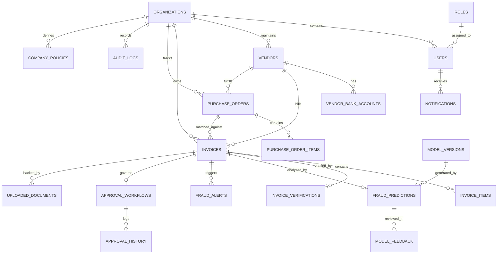

# FinGuard AI: Database Schema & Entity Relationship Design

## 1. Schema Design Principles
The FinGuard AI database schema is architected to guarantee:
- **Strict Multi-Tenancy**: Every business entity links to `organization_id` with composite indexes for performant tenant-scoped queries.
- **Auditable Financial Accuracy**: Currency fields use high-precision numerical types (`NUMERIC(14, 2)`) to avoid floating-point inaccuracies.
- **Temporal Integrity**: All temporal attributes store standardized UTC timestamps (`TIMESTAMP WITH TIME ZONE`).
- **Referential Integrity**: Foreign keys enforce relational validity with deliberate cascade or restrict policies.

---

## 2. Entity-Relationship Overview

---

## 3. Data Dictionary: 20 Core Entities

### 1. `organizations`
Primary business entity partition.
- `id`: VARCHAR(36) / UUID (Primary Key)
- `name`: VARCHAR(255) NOT NULL
- `slug`: VARCHAR(100) UNIQUE NOT NULL
- `currency`: VARCHAR(3) DEFAULT 'USD'
- `country`: VARCHAR(100) DEFAULT 'US'
- `is_active`: BOOLEAN DEFAULT TRUE
- `risk_tolerance_threshold`: NUMERIC(5, 2) DEFAULT 60.00
- `created_at`: TIMESTAMP WITH TIME ZONE DEFAULT UTC_NOW
- `updated_at`: TIMESTAMP WITH TIME ZONE DEFAULT UTC_NOW

### 2. `roles`
System-defined role catalogue (`ADMIN`, `FINANCE_MANAGER`, `FINANCE_EMPLOYEE`, `AUDITOR`).
- `id`: VARCHAR(36) (Primary Key)
- `name`: VARCHAR(50) UNIQUE NOT NULL
- `description`: TEXT
- `permissions`: JSONB / TEXT (Array of permission strings)
- `created_at`: TIMESTAMP WITH TIME ZONE DEFAULT UTC_NOW

### 3. `users`
Authenticated operators within a tenant organization.
- `id`: VARCHAR(36) (Primary Key)
- `organization_id`: VARCHAR(36) REFERENCES organizations(id) ON DELETE CASCADE
- `role_id`: VARCHAR(36) REFERENCES roles(id)
- `email`: VARCHAR(255) NOT NULL
- `hashed_password`: VARCHAR(255) NOT NULL
- `first_name`: VARCHAR(100) NOT NULL
- `last_name`: VARCHAR(100) NOT NULL
- `department`: VARCHAR(100)
- `is_active`: BOOLEAN DEFAULT TRUE
- `last_login_at`: TIMESTAMP WITH TIME ZONE
- `created_at`: TIMESTAMP WITH TIME ZONE DEFAULT UTC_NOW
- `updated_at`: TIMESTAMP WITH TIME ZONE DEFAULT UTC_NOW
- *Constraint*: UNIQUE (`organization_id`, `email`)

### 4. `vendors`
Approved and active vendor directory.
- `id`: VARCHAR(36) (Primary Key)
- `organization_id`: VARCHAR(36) REFERENCES organizations(id) ON DELETE CASCADE
- `vendor_code`: VARCHAR(50) NOT NULL
- `name`: VARCHAR(255) NOT NULL
- `gstin`: VARCHAR(50)
- `tax_id`: VARCHAR(50)
- `email`: VARCHAR(255)
- `phone`: VARCHAR(50)
- `address`: TEXT
- `risk_score`: NUMERIC(5, 2) DEFAULT 0.00
- `risk_level`: VARCHAR(20) DEFAULT 'LOW' (LOW, MEDIUM, HIGH, CRITICAL)
- `is_verified`: BOOLEAN DEFAULT FALSE
- `verified_by_user_id`: VARCHAR(36) REFERENCES users(id)
- `verified_at`: TIMESTAMP WITH TIME ZONE
- `created_at`: TIMESTAMP WITH TIME ZONE DEFAULT UTC_NOW
- `updated_at`: TIMESTAMP WITH TIME ZONE DEFAULT UTC_NOW
- *Constraint*: UNIQUE (`organization_id`, `vendor_code`)

### 5. `vendor_bank_accounts`
Bank account disbursement targets for verified vendors.
- `id`: VARCHAR(36) (Primary Key)
- `vendor_id`: VARCHAR(36) REFERENCES vendors(id) ON DELETE CASCADE
- `organization_id`: VARCHAR(36) REFERENCES organizations(id) ON DELETE CASCADE
- `bank_name`: VARCHAR(150) NOT NULL
- `account_number`: VARCHAR(50) NOT NULL
- `ifsc_swift_code`: VARCHAR(50) NOT NULL
- `account_holder_name`: VARCHAR(255) NOT NULL
- `is_primary`: BOOLEAN DEFAULT TRUE
- `is_verified`: BOOLEAN DEFAULT FALSE
- `requires_manager_approval`: BOOLEAN DEFAULT FALSE
- `verified_by_user_id`: VARCHAR(36) REFERENCES users(id)
- `verified_at`: TIMESTAMP WITH TIME ZONE
- `created_at`: TIMESTAMP WITH TIME ZONE DEFAULT UTC_NOW
- `updated_at`: TIMESTAMP WITH TIME ZONE DEFAULT UTC_NOW

### 6. `purchase_orders`
Registered PO contracts against which invoices are reconciled.
- `id`: VARCHAR(36) (Primary Key)
- `organization_id`: VARCHAR(36) REFERENCES organizations(id) ON DELETE CASCADE
- `vendor_id`: VARCHAR(36) REFERENCES vendors(id) ON DELETE RESTRICT
- `po_number`: VARCHAR(100) NOT NULL
- `issue_date`: DATE NOT NULL
- `expected_delivery_date`: DATE
- `total_amount`: NUMERIC(14, 2) NOT NULL
- `utilized_amount`: NUMERIC(14, 2) DEFAULT 0.00
- `status`: VARCHAR(30) DEFAULT 'ACTIVE' (ACTIVE, FULFILLED, CANCELLED)
- `notes`: TEXT
- `created_at`: TIMESTAMP WITH TIME ZONE DEFAULT UTC_NOW
- `updated_at`: TIMESTAMP WITH TIME ZONE DEFAULT UTC_NOW
- *Constraint*: UNIQUE (`organization_id`, `po_number`)

### 7. `purchase_order_items`
Line items belonging to an authorized Purchase Order.
- `id`: VARCHAR(36) (Primary Key)
- `purchase_order_id`: VARCHAR(36) REFERENCES purchase_orders(id) ON DELETE CASCADE
- `item_description`: TEXT NOT NULL
- `quantity`: NUMERIC(10, 2) NOT NULL
- `unit_price`: NUMERIC(14, 2) NOT NULL
- `tax_amount`: NUMERIC(14, 2) DEFAULT 0.00
- `total_price`: NUMERIC(14, 2) NOT NULL
- `created_at`: TIMESTAMP WITH TIME ZONE DEFAULT UTC_NOW

### 8. `invoices`
Core financial records undergoing fraud and compliance screening.
- `id`: VARCHAR(36) (Primary Key)
- `organization_id`: VARCHAR(36) REFERENCES organizations(id) ON DELETE CASCADE
- `vendor_id`: VARCHAR(36) REFERENCES vendors(id) ON DELETE RESTRICT
- `purchase_order_id`: VARCHAR(36) REFERENCES purchase_orders(id) ON DELETE SET NULL
- `invoice_number`: VARCHAR(100) NOT NULL
- `invoice_date`: DATE NOT NULL
- `due_date`: DATE
- `subtotal_amount`: NUMERIC(14, 2) NOT NULL
- `tax_amount`: NUMERIC(14, 2) DEFAULT 0.00
- `total_amount`: NUMERIC(14, 2) NOT NULL
- `currency`: VARCHAR(3) DEFAULT 'USD'
- `payment_terms`: VARCHAR(100)
- `document_hash`: VARCHAR(64) NOT NULL (SHA-256)
- `status`: VARCHAR(30) DEFAULT 'PENDING_VERIFICATION' (DRAFT, PENDING_VERIFICATION, UNDER_INVESTIGATION, APPROVED, REJECTED, CANCELLED)
- `risk_score`: NUMERIC(5, 2) DEFAULT 0.00
- `risk_level`: VARCHAR(20) DEFAULT 'LOW' (LOW, MEDIUM, HIGH, CRITICAL)
- `uploaded_by_user_id`: VARCHAR(36) REFERENCES users(id)
- `is_synthetic`: BOOLEAN DEFAULT FALSE
- `created_at`: TIMESTAMP WITH TIME ZONE DEFAULT UTC_NOW
- `updated_at`: TIMESTAMP WITH TIME ZONE DEFAULT UTC_NOW

### 9. `invoice_items`
Disaggregated items extracted from the invoice document.
- `id`: VARCHAR(36) (Primary Key)
- `invoice_id`: VARCHAR(36) REFERENCES invoices(id) ON DELETE CASCADE
- `item_description`: TEXT NOT NULL
- `quantity`: NUMERIC(10, 2) NOT NULL
- `unit_price`: NUMERIC(14, 2) NOT NULL
- `tax_rate`: NUMERIC(5, 2) DEFAULT 0.00
- `tax_amount`: NUMERIC(14, 2) DEFAULT 0.00
- `total_price`: NUMERIC(14, 2) NOT NULL
- `created_at`: TIMESTAMP WITH TIME ZONE DEFAULT UTC_NOW

### 10. `uploaded_documents`
Binary file metadata and physical disk storage pointers.
- `id`: VARCHAR(36) (Primary Key)
- `organization_id`: VARCHAR(36) REFERENCES organizations(id) ON DELETE CASCADE
- `invoice_id`: VARCHAR(36) REFERENCES invoices(id) ON DELETE SET NULL
- `filename`: VARCHAR(255) NOT NULL
- `stored_filename`: VARCHAR(255) NOT NULL
- `file_path`: VARCHAR(500) NOT NULL
- `file_size_bytes`: INTEGER NOT NULL
- `mime_type`: VARCHAR(100) NOT NULL
- `sha256_checksum`: VARCHAR(64) NOT NULL
- `ocr_status`: VARCHAR(30) DEFAULT 'PENDING' (PENDING, PROCESSING, COMPLETED, FAILED)
- `raw_ocr_payload`: JSONB / TEXT
- `created_at`: TIMESTAMP WITH TIME ZONE DEFAULT UTC_NOW

### 11. `invoice_verifications`
Deterministic rule-engine evaluations and automated validation outcomes.
- `id`: VARCHAR(36) (Primary Key)
- `invoice_id`: VARCHAR(36) REFERENCES invoices(id) ON DELETE CASCADE
- `vendor_matched`: BOOLEAN DEFAULT TRUE
- `vendor_details_match_score`: NUMERIC(5, 2) DEFAULT 100.00
- `bank_details_matched`: BOOLEAN DEFAULT TRUE
- `bank_recently_changed`: BOOLEAN DEFAULT FALSE
- `gstin_verified`: BOOLEAN DEFAULT TRUE
- `po_matched`: BOOLEAN DEFAULT TRUE
- `po_amount_exceeded`: BOOLEAN DEFAULT FALSE
- `duplicate_detected`: BOOLEAN DEFAULT FALSE
- `duplicate_matched_invoice_id`: VARCHAR(36) REFERENCES invoices(id)
- `duplicate_match_reason`: TEXT
- `tax_calculation_valid`: BOOLEAN DEFAULT TRUE
- `calculated_tax_discrepancy`: NUMERIC(14, 2) DEFAULT 0.00
- `verification_flags`: JSONB / TEXT
- `completed_at`: TIMESTAMP WITH TIME ZONE DEFAULT UTC_NOW

### 12. `model_versions`
Registry of supervised and unsupervised ML models in the system.
- `id`: VARCHAR(36) (Primary Key)
- `model_name`: VARCHAR(100) NOT NULL (e.g. 'xgboost_fraud_v1', 'isolation_forest_v1')
- `algorithm`: VARCHAR(50) NOT NULL
- `version_tag`: VARCHAR(50) NOT NULL
- `artifact_path`: VARCHAR(500) NOT NULL
- `training_sample_count`: INTEGER NOT NULL
- `evaluation_metrics`: JSONB / TEXT (Accuracy, Precision, Recall, F1, ROC-AUC)
- `is_active`: BOOLEAN DEFAULT TRUE
- `created_at`: TIMESTAMP WITH TIME ZONE DEFAULT UTC_NOW

### 13. `fraud_predictions`
Individual machine learning scoring records generated per invoice.
- `id`: VARCHAR(36) (Primary Key)
- `invoice_id`: VARCHAR(36) REFERENCES invoices(id) ON DELETE CASCADE
- `model_version_id`: VARCHAR(36) REFERENCES model_versions(id)
- `supervised_fraud_probability`: NUMERIC(5, 4) NOT NULL (0.0000 - 1.0000)
- `isolation_forest_anomaly_score`: NUMERIC(5, 4) NOT NULL (-1.0000 - 1.0000)
- `composite_risk_score`: NUMERIC(5, 2) NOT NULL (0.00 - 100.00)
- `feature_importance_shap`: JSONB / TEXT (SHAP feature values)
- `natural_language_explanation`: TEXT
- `recommended_action`: VARCHAR(50) DEFAULT 'REVIEW' (APPROVE, REVIEW, INVESTIGATE, REJECT)
- `created_at`: TIMESTAMP WITH TIME ZONE DEFAULT UTC_NOW

### 14. `fraud_alerts`
Actionable notifications and incident cases flagged by the risk pipeline.
- `id`: VARCHAR(36) (Primary Key)
- `organization_id`: VARCHAR(36) REFERENCES organizations(id) ON DELETE CASCADE
- `invoice_id`: VARCHAR(36) REFERENCES invoices(id) ON DELETE CASCADE
- `severity`: VARCHAR(20) NOT NULL (LOW, MEDIUM, HIGH, CRITICAL)
- `alert_title`: VARCHAR(255) NOT NULL
- `alert_description`: TEXT NOT NULL
- `investigation_status`: VARCHAR(30) DEFAULT 'NEW' (NEW, UNDER_INVESTIGATION, CONFIRMED_FRAUD, LEGITIMATE, ESCALATED, RESOLVED)
- `assigned_to_user_id`: VARCHAR(36) REFERENCES users(id)
- `resolution_notes`: TEXT
- `resolved_at`: TIMESTAMP WITH TIME ZONE
- `created_at`: TIMESTAMP WITH TIME ZONE DEFAULT UTC_NOW
- `updated_at`: TIMESTAMP WITH TIME ZONE DEFAULT UTC_NOW

### 15. `approval_workflows`
State machine orchestrating human review of invoices.
- `id`: VARCHAR(36) (Primary Key)
- `invoice_id`: VARCHAR(36) REFERENCES invoices(id) ON DELETE CASCADE
- `organization_id`: VARCHAR(36) REFERENCES organizations(id) ON DELETE CASCADE
- `current_stage`: VARCHAR(50) DEFAULT 'MANAGER_REVIEW' (EMPLOYEE_SUBMITTED, MANAGER_REVIEW, AUDIT_REVIEW, FINALIZED)
- `current_status`: VARCHAR(30) DEFAULT 'PENDING' (PENDING, APPROVED, REJECTED, ON_HOLD)
- `requires_dual_authorization`: BOOLEAN DEFAULT FALSE
- `approval_limit`: NUMERIC(14, 2)
- `created_at`: TIMESTAMP WITH TIME ZONE DEFAULT UTC_NOW
- `updated_at`: TIMESTAMP WITH TIME ZONE DEFAULT UTC_NOW

### 16. `approval_history`
Chronological transaction audit of approval decisions.
- `id`: VARCHAR(36) (Primary Key)
- `approval_workflow_id`: VARCHAR(36) REFERENCES approval_workflows(id) ON DELETE CASCADE
- `reviewer_user_id`: VARCHAR(36) REFERENCES users(id)
- `action_taken`: VARCHAR(30) NOT NULL (SUBMITTED, APPROVED, REJECTED, ESCALATED, REQUESTED_CHANGES)
- `reason`: TEXT
- `action_timestamp`: TIMESTAMP WITH TIME ZONE DEFAULT UTC_NOW

### 17. `model_feedback`
Human ground truth captured during review to facilitate governed retraining.
- `id`: VARCHAR(36) (Primary Key)
- `organization_id`: VARCHAR(36) REFERENCES organizations(id) ON DELETE CASCADE
- `invoice_id`: VARCHAR(36) REFERENCES invoices(id) ON DELETE CASCADE
- `fraud_prediction_id`: VARCHAR(36) REFERENCES fraud_predictions(id)
- `reviewer_user_id`: VARCHAR(36) REFERENCES users(id)
- `ground_truth_label`: VARCHAR(30) NOT NULL (CONFIRMED_FRAUD, LEGITIMATE, FALSE_POSITIVE, POLICY_EXCEPTION)
- `feedback_notes`: TEXT
- `is_verified_for_training`: BOOLEAN DEFAULT FALSE
- `verified_by_user_id`: VARCHAR(36) REFERENCES users(id)
- `created_at`: TIMESTAMP WITH TIME ZONE DEFAULT UTC_NOW

### 18. `company_policies`
Corporate compliance criteria, approval thresholds, and RAG knowledge base.
- `id`: VARCHAR(36) (Primary Key)
- `organization_id`: VARCHAR(36) REFERENCES organizations(id) ON DELETE CASCADE
- `policy_title`: VARCHAR(255) NOT NULL
- `category`: VARCHAR(50) NOT NULL (DISBURSEMENT_LIMITS, VENDOR_ONBOARDING, TAX_COMPLIANCE, FRAUD_ESCALATION)
- `policy_content`: TEXT NOT NULL
- `is_active`: BOOLEAN DEFAULT TRUE
- `created_at`: TIMESTAMP WITH TIME ZONE DEFAULT UTC_NOW
- `updated_at`: TIMESTAMP WITH TIME ZONE DEFAULT UTC_NOW

### 19. `notifications`
User alert inbox for critical operational events.
- `id`: VARCHAR(36) (Primary Key)
- `organization_id`: VARCHAR(36) REFERENCES organizations(id) ON DELETE CASCADE
- `user_id`: VARCHAR(36) REFERENCES users(id) ON DELETE CASCADE
- `title`: VARCHAR(255) NOT NULL
- `message`: TEXT NOT NULL
- `type`: VARCHAR(30) DEFAULT 'INFO' (INFO, WARNING, ALERT, SUCCESS)
- `link`: VARCHAR(255)
- `is_read`: BOOLEAN DEFAULT FALSE
- `created_at`: TIMESTAMP WITH TIME ZONE DEFAULT UTC_NOW

### 20. `audit_logs`
Immutable compliance and forensic log tracking every administrative and business operation.
- `id`: VARCHAR(36) (Primary Key)
- `organization_id`: VARCHAR(36) REFERENCES organizations(id) ON DELETE CASCADE
- `user_id`: VARCHAR(36) REFERENCES users(id) ON DELETE SET NULL
- `user_email`: VARCHAR(255)
- `action`: VARCHAR(100) NOT NULL
- `resource_type`: VARCHAR(50) NOT NULL
- `resource_id`: VARCHAR(36)
- `ip_address`: VARCHAR(45)
- `user_agent`: VARCHAR(255)
- `previous_values`: JSONB / TEXT
- `new_values`: JSONB / TEXT
- `timestamp`: TIMESTAMP WITH TIME ZONE DEFAULT UTC_NOW
