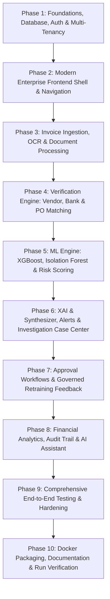

# FinGuard AI: Implementation Roadmap & Engineering Plan

This roadmap outlines the disciplined, phased execution strategy for FinGuard AI, moving from foundational architecture to full deployment.

---

## Roadmap Phases Overview

---

## Detailed Phase Breakdown

### Phase 1: Project Setup, Database Schema, Multi-Tenant Auth
- **Deliverables**:
  - Monorepo directory structure (`frontend`, `backend`, `ml-engine`, `storage`, `docs`).
  - Python virtual environment and dependencies (`fastapi`, `uvicorn`, `sqlalchemy`, `pydantic`, `python-jose`, `passlib`, `pytest`, `pandas`, `scikit-learn`, `xgboost`, `shap`, `pymupdf`).
  - SQLAlchemy models for all 20 entities with multi-tenant scoping and indexing.
  - JWT token utilities with refresh tokens, password hashing, and role permissions.
  - Initial seed script provisioning default roles (`ADMIN`, `FINANCE_MANAGER`, `FINANCE_EMPLOYEE`, `AUDITOR`) and demo organizations.
  - Unit tests verifying authentication, role enforcement, and cross-tenant isolation.

### Phase 2: Enterprise Frontend Shell & User Management
- **Deliverables**:
  - React + TypeScript + Vite + Tailwind CSS scaffold with Stripe/Linear-grade design.
  - Auth context and Axios interceptors handling bearer tokens and tenant context.
  - Role-protected routes ensuring unauthorized roles cannot access sensitive pages.
  - Global navigation (Sidebar, Topbar with notification bells, Tenant selector, User profile).
  - User & Role management interface for `ADMIN` to invite, activate, and manage company users.
  - Dashboard layout with real backend statistics binding.

### Phase 3: Invoice Upload, Multi-Format OCR & Review
- **Deliverables**:
  - Secure upload endpoint supporting PDF, JPG, JPEG, and PNG up to 15MB.
  - SHA-256 document hashing and file system storage partitioning.
  - PyMuPDF text & table extraction parser mapping invoice fields (amounts, dates, line items, bank accounts).
  - Frontend interactive invoice review workspace with document split-screen viewer and editable OCR fields.
  - Data persistence separating raw OCR extracts from employee-corrected verified values.

### Phase 4: Deterministic Verification & Matching Engines
- **Deliverables**:
  - **Vendor Verification Service**: Validates vendor existence, tax ID / GSTIN legitimacy, and flags recent bank account changes requiring manager sign-off.
  - **Duplicate Detection Engine**: Exact SHA-256 match, invoice number fuzzy match, and vendor-amount-date collision detector.
  - **Purchase Order Reconciliation**: PO 3-way matching checking line item quantities, unit prices, and overall PO budget utilization.
  - Automated verification summary dashboard tab per invoice.

### Phase 5: Machine Learning Pipeline & Calibrated Risk Scorer
- **Deliverables**:
  - Feature engineering module extracting 16 tabular and ratio features from invoice and vendor history.
  - Synthetic dataset generator (`generate_synthetic_dataset.py`) producing 1,000+ realistic labeled transactions.
  - Supervised **XGBoost Classifier** training pipeline with cross-validation and AUC-PR metrics.
  - Unsupervised **Isolation Forest** outlier model detecting anomalous spending patterns.
  - Unified **Composite Risk Scoring Engine** calibrating rule violations and ML scores into 0–100 risk levels (`LOW`, `MEDIUM`, `HIGH`, `CRITICAL`).

### Phase 6: Explainable AI (SHAP), Alerts & Forensic Investigations
- **Deliverables**:
  - SHAP tree explainer integration delivering exact feature attribution for risk scores.
  - AI Explanation Synthesizer converting deterministic facts and SHAP rankings into human-readable rationale without hallucination.
  - Centralized **Fraud Detection Center** & **Alert Management** page with severity badges, filters, and assignment tools.
  - Case investigation workflow tracking statuses (`NEW`, `UNDER_INVESTIGATION`, `CONFIRMED_FRAUD`, `LEGITIMATE`, `RESOLVED`).

### Phase 7: Human Approval Workflow & Governed Model Feedback
- **Deliverables**:
  - Multi-tier approval state machine enforcing manual review for high-risk invoices and dual-signoff for elevated disbursements.
  - Finance Manager approval and rejection UI with mandatory audit commentary.
  - Model feedback capture logging verified ground truth labels (`CONFIRMED_FRAUD` vs `FALSE_POSITIVE`).
  - Governed model registry tracking model versions, metrics, and rollback capabilities.

### Phase 8: Financial Analytics, Audit Trail & AI Policy Assistant
- **Deliverables**:
  - Executive Financial Intelligence dashboard with Recharts visualizations (prevented fraud value, department exposure, risk distributions).
  - Immutable **Audit Log Viewer** displaying detailed chronological records of all operations.
  - In-app **AI Financial Assistant** equipped with permission-aware RAG querying company financial policies and invoice records without cross-tenant leakage.
  - Data export endpoints for CSV, PDF, and Excel summaries.

### Phase 9: Testing, Security Hardening & Validation
- **Deliverables**:
  - Comprehensive pytest suite covering auth, tenant isolation, OCR, rules, ML inference, and approval states.
  - Frontend testing and API contract verification.
  - Security audit verifying zero cross-tenant query leakage, sanitized file uploads, and rate limits.

### Phase 10: Dockerization, Documentation & Final Delivery
- **Deliverables**:
  - Production-ready `Dockerfile` for Backend and Frontend.
  - `docker-compose.yml` linking FastAPI, PostgreSQL, Nginx, and storage volumes.
  - Comprehensive `README.md` and API documentation.
  - End-to-end smoke test demonstrating full functionality across all 4 user roles.
