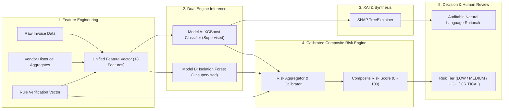

# FinGuard AI: Machine Learning Architecture & Fraud Detection Pipeline

## 1. Machine Learning Philosophy & Fraud Principles
1. **Separation of Concerns**: An unusual invoice is *not* inherently fraudulent. FinGuard AI explicitly decouples:
   - **Anomaly Score** ($S_{iso} \in [-1, 1]$): Quantifies deviation from typical multi-dimensional spending behavior.
   - **Supervised Fraud Probability** ($P_{xgb} \in [0, 1]$): Estimates likelihood of malicious deceit calibrated against labeled historical patterns.
   - **Deterministic Violation Score** ($V_{rules} \in [0, 100]$): Hard rule violations (e.g., altered bank account, duplicate invoice hash, non-existent PO).
2. **Explainable AI (XAI)**: No "black box" decisions. Every model inference provides exact SHAP values detailing how each feature pushed the risk score upward or downward.
3. **Prevention of Data Leakage**: Temporal splitting and cross-validation; target labels are never derived from future states or test partitions.
4. **Governed Self-Learning**: Unverified feedback never auto-deploys to production. Only human-audited labels in the model registry can be promoted via verified retraining gates.

---

## 2. ML Pipeline Architecture

---

## 3. Feature Engineering Specification

For each invoice $i$ issued by vendor $v$ at time $t$, the feature pipeline generates:

| Feature Name | Description | Source / Formula |
| :--- | :--- | :--- |
| `amount` | Total billed currency amount | Extracted invoice total |
| `amount_to_vendor_mean_ratio` | Ratio of current amount to vendor's 90-day moving average | $A_i / (\mu_{v, 90d} + \epsilon)$ |
| `amount_z_score` | Standard score of amount compared to vendor history | $(A_i - \mu_v) / (\sigma_v + 1)$ |
| `vendor_invoice_frequency_30d` | Invoices submitted by vendor in trailing 30 days | Windowed transaction count |
| `vendor_age_days` | Elapsed days since vendor was first onboarded | $t_{current} - t_{vendor\_created}$ |
| `bank_account_changed_recent` | Binary flag: bank details modified within past 30 days | `1` if recent change, else `0` |
| `gstin_match_flag` | Binary flag indicating vendor GSTIN matches government tax ID | `1` if mismatch, `0` if matched |
| `po_match_discrepancy_ratio` | Percentage difference between PO total and Invoice total | $\|A_{inv} - A_{po}\| / A_{po}$ |
| `po_line_item_count_mismatch` | Absolute discrepancy between PO items and invoice items | $\|N_{inv\_items} - N_{po\_items}\|$ |
| `duplicate_similarity_score` | Fuzzy & exact score against previous invoices (0 to 1) | String distance + amount proximity |
| `invoice_weekend_submission` | Binary flag: submitted on Saturday/Sunday | `1` if weekend, else `0` |
| `invoice_round_amount_flag` | Binary flag: ends in multiple zeros (e.g. $50,000.00) | `1` if divisible by 1000, else `0` |
| `days_to_due_date` | Payment window duration | $t_{due} - t_{invoice}$ |
| `historical_fraud_count_vendor`| Count of prior flagged or confirmed fraud cases for vendor | Count from audit DB |
| `item_price_variance_ratio` | Maximum item unit price variance against PO agreement | $\max(P_{item} / P_{agreed})$ |
| `unregistered_vendor_flag` | Invoiced by entity not found in verified vendor ledger | `1` if unregistered |

---

## 4. Model A: Supervised XGBoost Classifier
- **Objective**: `binary:logistic`
- **Hyperparameters**:
  - `max_depth`: 4 (avoids overfitting on sparse fraud patterns)
  - `learning_rate`: 0.05
  - `n_estimators`: 150
  - `scale_pos_weight`: Handled via class rebalancing (fraud instances typically ~2–5% of volume)
  - `eval_metric`: `aucpr` (Precision-Recall AUC prioritization over ROC-AUC for imbalanced distributions)
- **Output**:
  - $P_{xgb} \in [0.00, 1.00]$ (Fraud probability)

---

## 5. Model B: Unsupervised Isolation Forest
- **Objective**: Detect novel spending vectors and abnormal dimensional outliers without labels.
- **Hyperparameters**:
  - `n_estimators`: 100
  - `contamination`: 0.04 (approximate anticipated outlier rate)
  - `random_state`: 42
- **Output**:
  - Raw decision function converted to normalized anomaly score $S_{iso} \in [0, 1]$.

---

## 6. Composite Risk Scoring Formula

The overall **Risk Score** $R \in [0, 100]$ is computed deterministically:

$$R = \min\left(100, \; w_1 \cdot (P_{xgb} \times 100) + w_2 \cdot (S_{iso} \times 100) + w_3 \cdot V_{rules}\right)$$

Where default calibrated weights are:
- $w_1 = 0.45$ (Supervised ML probability)
- $w_2 = 0.20$ (Isolation Forest anomaly score)
- $w_3 = 0.35$ (Deterministic rule violation penalties)

### Risk Classification Tiers
- **0.00 – 29.99**: **LOW RISK** (Eligible for straight-through automated verification if all checks pass).
- **30.00 – 59.99**: **MEDIUM RISK** (Requires standard single-stage Finance Review).
- **60.00 – 79.99**: **HIGH RISK** (Triggers high-priority Fraud Alert; dual-authorization required).
- **80.00 – 100.00**: **CRITICAL RISK** (Immediate payment hold; mandatory forensic investigation).

---

## 7. Synthetic Dataset Generation & Benchmarking
To guarantee immediate, reproducible functionality and verification without relying on external private corporate invoices, FinGuard AI includes an enterprise synthetic generator (`ml-engine/training/generate_synthetic_dataset.py`):
- Generates 1,000+ realistic enterprise invoices across 25 diverse vendors.
- Explicitly flags all generated records with `is_synthetic = True`.
- Injects 6 real-world fraud archetypes:
  1. *Duplicate billing* (same amount & PO with slight invoice number variant).
  2. *Sudden bank account modification* followed by inflated transfer request.
  3. *Unregistered ghost vendor* with no matching corporate tax ID.
  4. *PO line item inflation* (unit prices 30–80% higher than contracted PO).
  5. *Unusual round-number milestone billing* on off-hours weekends.
  6. *Velocity spike* (vendor submitting 8 invoices in 3 days vs historical 1/month).
