# FinGuard AI: Project Architecture & System Design Document

## 1. System Overview & Executive Summary

**FinGuard AI** is an enterprise-grade financial fraud prevention and risk intelligence platform designed to intercept fraudulent, duplicate, inflated, and non-compliant vendor invoices *before* disbursement. 

The platform integrates:
1. **Multi-tenant Organization Architecture**: Complete data isolation across corporations and business entities.
2. **Role-Based Access Control (RBAC)**: Distinct authorization matrix for `ADMIN`, `FINANCE_MANAGER`, `FINANCE_EMPLOYEE`, and `AUDITOR`.
3. **Automated Document Ingestion & Hybrid OCR**: Multi-format extraction (PDF, JPG, JPEG, PNG) via PyMuPDF and OCR parsers with employee human-in-the-loop review.
4. **Deterministic Rule Engines**: High-precision checks for vendor mismatch, bank account alterations, GSTIN legitimacy, duplicate hashing, and purchase order budget ceilings.
5. **Machine Learning Fraud & Anomaly Engines**:
   - **XGBoost Classifier**: Supervised classification for fraud probability based on engineered historical risk features.
   - **Isolation Forest**: Unsupervised anomaly detection detecting high-dimensional deviations without requiring prior fraud tags.
   - **Calibrated Multi-Signal Composite Risk Scorer**: Composite scoring (0–100) separating fraud probability, anomaly magnitude, and policy violation severity.
6. **Explainable AI (XAI)**: Feature-level contribution via SHAP scores coupled with a governed LLM synthesizer converting deterministic facts into auditable human explanations.
7. **Human Approval Workflow & Self-Learning Feedback Loop**: Enforced manual review gates for elevated risk tiers, recording verified human ground truth into versioned datasets for governed retraining.
8. **Real-time Financial Analytics & Conversational Financial Assistant**: Real-time spending risk vectors, audit logs, and permission-aware RAG policy assistant.

---

## 2. High-Level Architectural Diagram

```mermaid
flowchart TD
    subgraph ClientLayer ["Client Layer (React + TypeScript + Vite + Tailwind CSS)"]
        UI_Dash["Executive Dashboard"]
        UI_Upload["Invoice Ingestion & OCR Review"]
        UI_Vendor["Vendor Directory & Risk Registry"]
        UI_PO["Purchase Order Matcher"]
        UI_Alerts["Fraud Alert & Case Management"]
        UI_Approval["Multi-Stage Approval Queue"]
        UI_Analytics["Financial Risk Analytics"]
        UI_Assistant["AI Assistant (RAG Chat)"]
        UI_Audit["Immutable Audit Log Viewer"]
    end

    subgraph GatewayLayer ["Security & Routing (FastAPI + Middleware)"]
        CORS["CORS & Origin Filtering"]
        AuthMid["JWT Auth & Tenant Isolation Middleware"]
        RateLimiter["Rate Limiting & Request Sanitizer"]
        AuditMid["Automatic Audit Trail Interceptor"]
    end

    subgraph ServiceLayer ["Core Backend Services"]
        AuthSvc["Authentication & Organization Service"]
        OCRSvc["OCR Engine (PyMuPDF / Image Parser)"]
        VendorSvc["Vendor Verification & Bank Change Tracker"]
        DupSvc["Duplicate Detection (Sha256 + Fuzzy Distance)"]
        POSvc["PO 3-Way Match & Tolerance Engine"]
        MLInference["ML Pipeline (XGBoost + Isolation Forest + SHAP)"]
        RiskEngine["Calibrated Composite Risk Aggregator"]
        XAIEngine["Explainability & LLM Synthesizer"]
        WorkflowSvc["Approval & Case State Machine"]
        FeedbackSvc["Feedback & Dataset Versioning Registry"]
        AssistantSvc["RAG Policy & Transaction Query Assistant"]
    end

    subgraph PersistenceLayer ["Persistence & File Storage"]
        DB[(PostgreSQL / SQLite Storage)]
        FileStore["Secure Document Storage (/storage/invoices)"]
        ModelRepo["Serialized Models (/ml-engine/artifacts)"]
    end

    ClientLayer --> GatewayLayer
    GatewayLayer --> ServiceLayer
    ServiceLayer --> PersistenceLayer
```

---

## 3. Component Architecture & Interactions

### 3.1 Frontend Architecture
- **Framework**: React 18+ with TypeScript, bundled with Vite.
- **Styling**: Tailwind CSS adhering to enterprise financial design guidelines (clean slate/navy palette, neutral cards, high contrast, zero frivolous animations).
- **State & Communication**: Axios HTTP client with interceptors for JWT token refresh, organization tenant headers, and centralized API error formatting.
- **Routing**: React Router v6 with strict Protected Route guards (`AdminRoute`, `FinanceManagerRoute`, `FinanceEmployeeRoute`, `AuditorRoute`).
- **Data Visualization**: Recharts for dynamic financial spend distributions, risk matrices, and trend lines.

### 3.2 Backend Service Architecture
- **Framework**: Python 3.11+ with FastAPI, utilizing asynchronous request handling and Pydantic v2 schemas for strict input/output validation.
- **Database Engine**: SQLAlchemy ORM with async capabilities. Multi-database support configured for PostgreSQL (production) with zero-friction development fallback to SQLite with equivalent schema constraints.
- **Security & Cryptography**: Passlib (Bcrypt) for salted password hashing; python-jose for standard RFC-7519 JSON Web Tokens with configurable expiration.

### 3.3 ML & OCR Subsystem
- **Invoice Extraction**: PyMuPDF (`fitz`) and optical character analysis for vector and raster PDF documents and high-resolution images.
- **Supervised Classifier**: XGBoost classification model trained on engineered invoice features (deviations from vendor mean, frequency spikes, bank change recency, PO discrepancy markers).
- **Unsupervised Anomaly Model**: Isolation Forest isolating dimensional outliers.
- **Explainability**: SHAP TreeExplainer quantifying marginal feature importance for every inference.
- **Synthetic Data Generator**: Deterministic, reproducible data generation pipeline generating realistic, edge-case financial transactions clearly flagged for benchmark and validation.

---

## 4. Multi-Tenant Isolation & Role Security

FinGuard AI implements strict tenant boundaries. Every query against financial data (`invoices`, `vendors`, `purchase_orders`, `fraud_alerts`, `audit_logs`) explicitly enforces the `organization_id` filter extracted from the authenticated user's verified JWT token.

### Role Authorization Matrix

| Capability / Resource | ADMIN | FINANCE_MANAGER | FINANCE_EMPLOYEE | AUDITOR |
| :--- | :---: | :---: | :---: | :---: |
| Organization & User Management | **CRUD** | None | None | Read Users |
| System Risk Settings & Thresholds | **CRUD** | Read | None | Read |
| Invoice Upload & OCR Correction | **Yes** | **Yes** | **Yes** | None |
| Invoice Approval / Rejection | None | **Yes** | None | None |
| Fraud Alert Case Investigation | Read | **Yes** (Investigate/Resolve) | Assigned Cases | Read Only |
| Vendor Registration & Bank Verification | Read/Manage | **Verify / Authorize** | Create Draft | Read Only |
| PO Upload & Maintenance | **Yes** | **Yes** | **Yes** | Read Only |
| Financial Risk Analytics & Exports | **Full** | **Full** | Departmental | **Full (Read Only)**|
| Immutable Audit Logs | **Full Read** | Read Relevant | None | **Full Read** |
| Model Retraining & Deployment Approval | **Authorize** | Label Feedback | None | Review Performance |

---

## 5. Security & Compliance Architecture

1. **Defense in Depth**: Zero trust parameter handling. All document uploads undergo MIME-type header inspection, size capping (max 15MB), and SHA-256 integrity digest calculations.
2. **Audit Logging**: Any state mutation (approval, rejection, role change, bank detail alteration, threshold update) triggers an asynchronous write to the immutable `audit_logs` table recording user ID, IP address, action tag, previous JSON state, and new JSON state.
3. **No Unsanctioned AI Execution**: AI models provide risk assessments and recommendations. The platform strictly prohibits autonomous fund disbursement or automated invoice approval for high-risk flags without human-in-the-loop validation.
